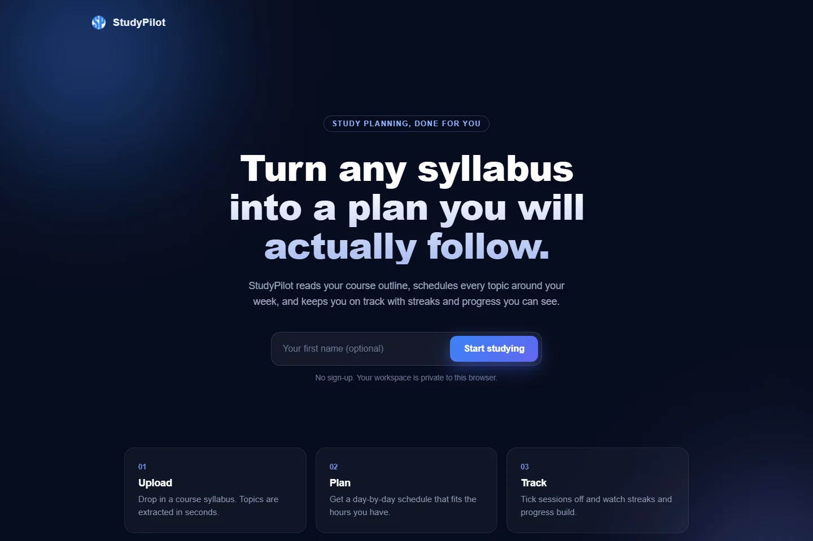
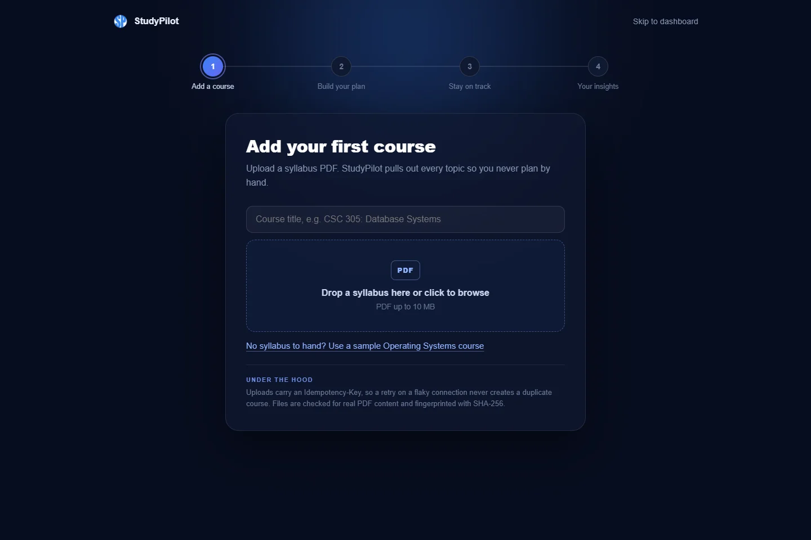
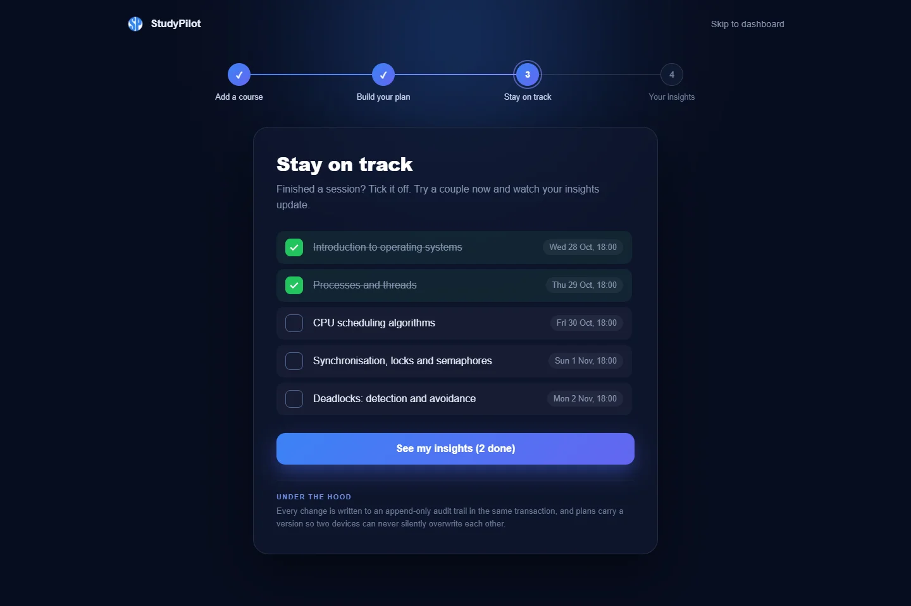
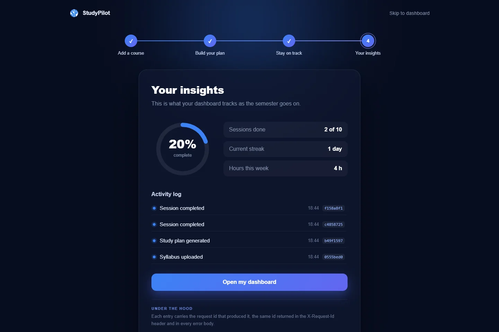
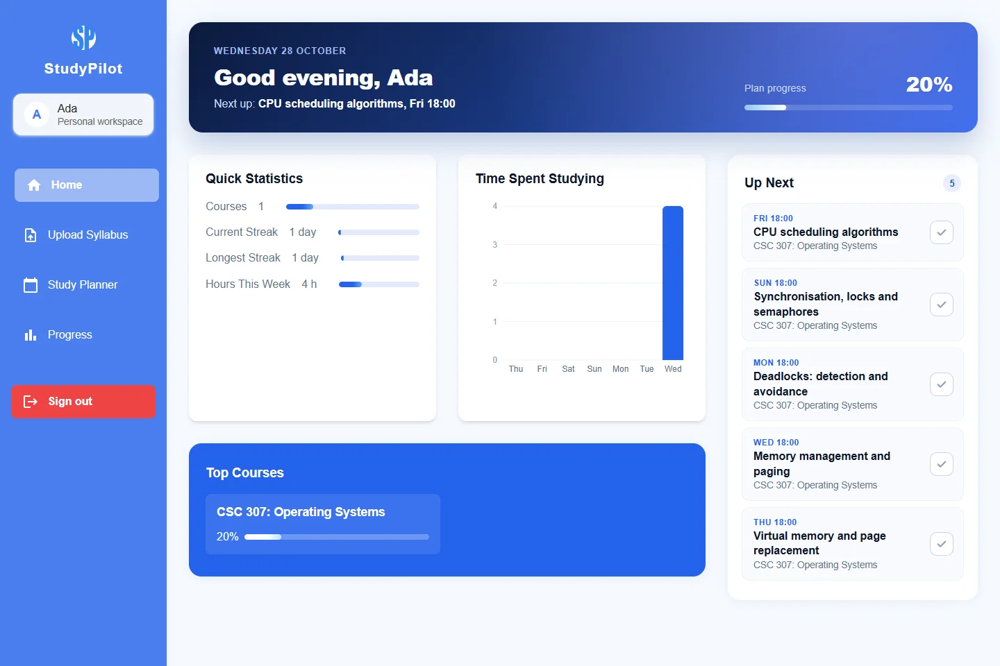
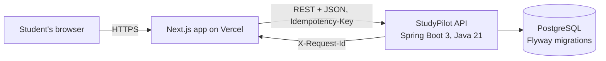
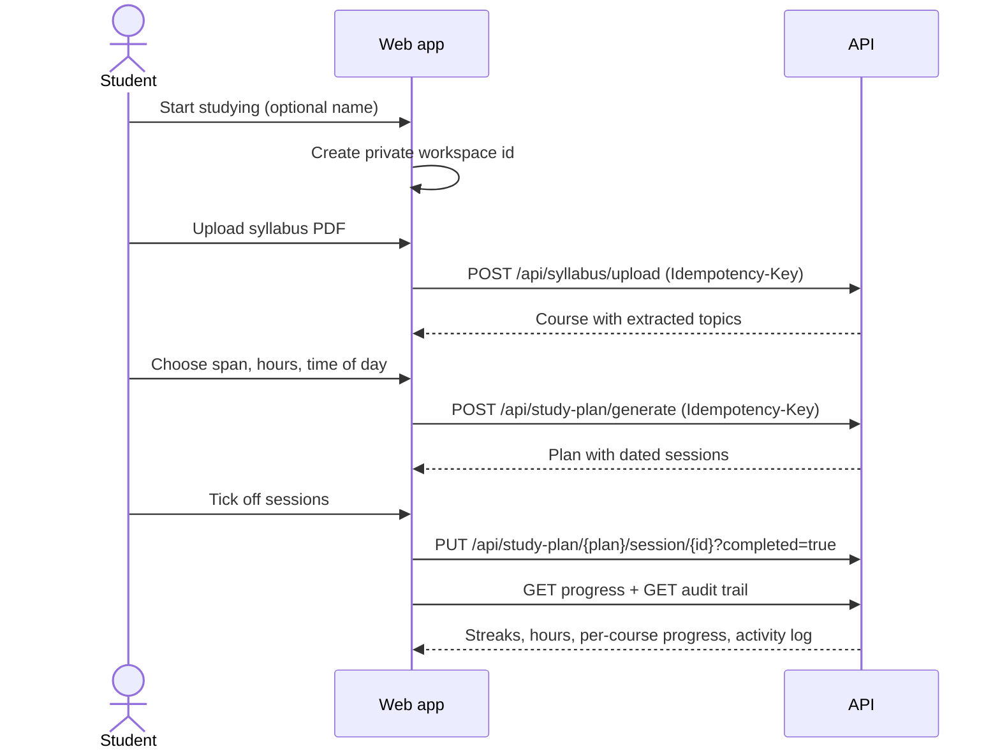

<div align="center">

# StudyPilot

**Turn any syllabus into a study plan you will actually follow.**

[](https://nextjs.org/)
[](https://react.dev/)
[](https://motion.dev/)
[](https://github.com/C-J7/SP)
[](https://studypilot.vercel.app)

[Live app](https://studypilot.vercel.app) · [API repository](https://github.com/C-J7/SP) · [API docs](https://sp-5rvl.onrender.com/swagger-ui.html) · [How it works](#how-it-works)



</div>

## Contents

- [What it does](#what-it-does)
- [Screenshots](#screenshots)
- [How it works](#how-it-works)
- [Tech stack](#tech-stack)
- [Getting started](#getting-started)
- [Project structure](#project-structure)
- [Design decisions](#design-decisions)
- [Known limitations](#known-limitations)
- [Roadmap](#roadmap)

## What it does

StudyPilot is the web client for the [StudyPilot API](https://github.com/C-J7/SP). A student drops in a course syllabus, and the app:

1. **Extracts the topics** from the PDF (weeks, modules, numbered and bulleted lines).
2. **Schedules them** across the days and hours the student has, at the time of day they prefer.
3. **Tracks the work** as sessions are ticked off, with streaks, hours per day and per-course progress.
4. **Shows the record**: every change appears in an activity log with the request id that produced it.

New visitors go through a four-step guided onboarding. It uses the real API end to end, with no mock data.

## Screenshots

| Add a course | Stay on track |
| --- | --- |
|  |  |
| **Your insights** | **Dashboard** |
|  |  |

## How it works

### System overview



### Guided onboarding



### Routes

| Route | Purpose |
| --- | --- |
| `/` | Start page. Creates a private workspace and opens the onboarding |
| `/start` | Four-step guided onboarding: add a course, build a plan, stay on track, insights |
| `/dashboard` | Progress banner, quick statistics, weekly study chart, courses and Up Next |
| `/dashboard/upload-syllabus` | Add another course |
| `/dashboard/study-planner` | Generate a plan for any uploaded course |
| `/dashboard/progress` | Detailed progress and streak history |

## Tech stack

| Layer | Choice |
| --- | --- |
| Framework | Next.js 14 (App Router), React 18 |
| Motion | Framer Motion: shared-layout transitions, staggered lists, animated progress ring |
| Charts | Recharts |
| HTTP | Axios with a single client in `src/app/api/services/api.js` |
| Styling | CSS Modules, no UI kit lock-in |
| Hosting | Vercel (web), Render (API) |

## Getting started

Prerequisites: Node.js 18 or newer, and either the hosted API or a local copy of [C-J7/SP](https://github.com/C-J7/SP) running on port 8080.

```bash
git clone https://github.com/C-J7/studypilot.git
cd studypilot
npm install
echo "NEXT_PUBLIC_API_URL=http://localhost:8080" > .env.local
npm run dev
```

Open http://localhost:3000.

| Variable | Required | Default | Purpose |
| --- | --- | --- | --- |
| `NEXT_PUBLIC_API_URL` | No | `https://sp-5rvl.onrender.com` | Base URL of the StudyPilot API |

| Script | What it does |
| --- | --- |
| `npm run dev` | Development server with fast refresh |
| `npm run build` | Production build |
| `npm start` | Serve the production build |
| `npm run lint` | ESLint |

## Project structure

```
src/
  app/
    page.js                 Start page
    start/                  Guided onboarding
    dashboard/              Dashboard, upload, planner and progress pages
    api/services/api.js     The only place that talks to the API
  components/               Cards, chart, uploader and shared UI
  contexts/AuthContext.js   Workspace identity
  styles/                   CSS Modules for components
public/sample-syllabus.pdf  Sample course used by the onboarding
docs/images/                README screenshots
```

## Design decisions

| Decision | Why |
| --- | --- |
| One API client module | Errors are normalised from RFC 9457 problem details in one place, so every screen shows the server's own message |
| Idempotency keys on every create | A double click or a retry on a slow network never creates a second course or plan |
| No mock data in the onboarding | Every number on screen comes from the API, so the onboarding exercises the real system |
| Private workspace instead of accounts | Anyone can try the full product in seconds without handing over an email address |
| Wake-up ping on the start page | The free-tier API sleeps when idle; the start page wakes it while the visitor reads |

## Known limitations

| Limitation | Impact | Workaround |
| --- | --- | --- |
| Workspaces are per browser, not accounts | Clearing site data or switching device starts a new workspace | Planned: sign-in with an identity provider and server-verified tokens |
| The API trusts the workspace id it is sent | Fine for a single-user demo, not for personal data | Planned: JWT validation on the API |
| Free-tier API sleeps after 15 minutes idle | First request can take up to a minute | The start page sends a wake-up request on load |
| No automated frontend tests yet | UI regressions are caught by hand | Planned: Playwright run of the onboarding in CI |

## Roadmap

- [x] Guided onboarding on the real API
- [x] Dashboard with streaks, weekly hours and per-course progress
- [x] Activity log backed by the API's audit trail
- [ ] Sign-in with server-verified tokens
- [ ] Calendar export (iCal) for generated plans
- [ ] Playwright end-to-end test of the onboarding in CI
